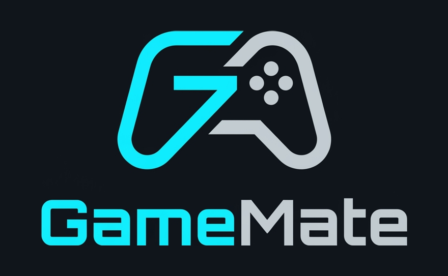

<p align="center">
  
</p>

# GameMate

**Your local AI gaming companion.**

GameMate is a Windows desktop app that puts an AI assistant beside you while you play. Press **Alt + Space** in the middle of a game, type your question, and get an answer without leaving the game. It recognizes the game you're playing, can look at your screen so you don't have to describe what you're seeing, reads your game's wiki when it isn't sure, knows the real Minecraft crafting recipes and your CurseForge modpacks, and if you like, it can watch your game and speak up when something important happens. You can even ask out loud and hear the answer.

By default everything runs **on your own computer**. GameMate comes with its own AI engine: download a model once from inside the app and it answers right on your PC, so your questions, screenshots and conversations stay there, there are no subscription or per-question fees, and it keeps working without an internet connection. Already use [Ollama](https://ollama.com)? GameMate can use your Ollama models instead. If you want smarter answers, you can switch on Google's Gemini with your own API key, and let GameMate look things up on your game's wiki.

## Features

- **Ask without leaving your game.** Press **Alt + Space** and a small window appears on top of your game. Type a question, read the answer, and press **Esc** to get back to playing.
- **All your games.** Click **Scan for games** and GameMate finds what you installed with Steam, Epic Games, Battle.net and Riot (VALORANT, Overwatch, Marvel Rivals, and so on), plus each game's wiki. Minecraft works out of the box. You can also add any game that's running.
- **Knows your modpack.** GameMate reads your CurseForge modpacks (and the pack that's running in other launchers), so it knows which mods you have, and can read what a mod does.
- **Real Minecraft recipes.** Ask "How do I craft a bookshelf?" and GameMate looks up the actual recipe and shows it as a crafting grid, instead of guessing. It uses the newest Minecraft, or your modpack's version.
- **Always-on companion (optional).** Turn on Commentary mode and GameMate watches your game, popping up a short comment when it spots danger, low health, a death or a great find. You decide how chatty it is.
- **Talk to it.** Press **Alt + V** and ask your question out loud. GameMate can read its answers and comments aloud, too. Speech recognition and the voice both run on your PC.
- **Ask about your screen.** Attach a screenshot of your game window or your whole screen and ask "What is this creature?" or "What should I do next?". GameMate picks your Minecraft window automatically when it's open.
- **Download and play.** No other installs: GameMate downloads its AI with one click the first time you open it. Choose from three models, from fast to best, or use your Ollama models.
- **Nothing left running.** GameMate's AI starts when you ask something, frees your graphics card after a few idle minutes, and stops completely when GameMate quits.
- **Chat window.** A full chat window for longer conversations.
- **Runs in the background.** Closing the window keeps GameMate in the system tray, ready for **Alt + Space**.
- **Looks things up.** Turn on lookups and GameMate reads your game's wiki (for example [minecraft.wiki](https://minecraft.wiki), the Terraria Wiki or Eldenpedia) for bosses, items, places and mechanics, and links to the page it used.
- **Shows pictures.** With lookups on, answers come with pictures from the wiki: ask for a map ("map of the Forgotten Crossroads") and you get the area map, ask about a boss or item and you see it, and Minecraft recipe cards show the real game icons and the crafted item.
- **Local or cloud, your choice.** Use the local model for everything, or Gemini for questions, the companion, or both.
- **Private by default.** No accounts, nothing uploaded, unless you choose Gemini or online lookups.

## Requirements

- Windows 10 or 11
- A graphics card is recommended for fast answers, especially while a game is running. NVIDIA, AMD and Intel cards all work, and GameMate picks your dedicated card automatically. Without one, GameMate uses the processor, which is slower.
- 2 to 7 GB of free disk space for the AI model, depending on which one you choose.

## Getting started

1. **Install GameMate.** Download the latest installer from the [Releases](https://github.com/TSCKey/gamemate/releases) page and run it.
2. **Open GameMate** and click **Download Qwen3.5 2B (1.9 GB)**. You only do this once. After that, GameMate's AI works offline.
3. **Start asking questions.**

Already use Ollama? Click **I use Ollama** instead, or switch any time in **⚙ Settings → Models**.

## Using GameMate

### In-game: Alt + Space

1. While playing, press **Alt + Space**. A small GameMate window appears on top of your game.
2. Type your question and press **Enter**.
3. Press **Esc** (or **Alt + Space** again) to hide it and keep playing.

- When the **📷** button is lit, GameMate includes a screenshot of your screen, taken at the moment you pressed **Alt + Space**. Click **📷** to turn this on or off. GameMate's own window never appears in the screenshot.
- Follow-up questions continue the same conversation. Click **✕** to start a new one. The conversation starts fresh by itself if you haven't used GameMate for 10 minutes.
- Drag the 🎮 icon to move the window.
- Prefer other keys? Click **Change** next to **Shortcut** (or **Voice shortcut**) in **⚙ Settings → General** and press the keys you want, for example **Ctrl + Shift + G** or **F9**. Shortcuts need Alt, the Windows key or Ctrl + Shift (or be an F key), so they don't get in the way of typing in other apps.
- For the window to appear over your game, set the game to **windowed** or **borderless/windowed fullscreen**. Windows doesn't let other apps draw over exclusive fullscreen.

### Games and modpacks

GameMate always helps with one game, shown at the top of the chat window (for example **VALORANT ▾**). Click it to switch games. Minecraft is always there; your other games come from a scan.

1. Open **⚙ Settings → Games**. GameMate explains what it would look at; tick **Allow GameMate to look for games on this PC** and click **Allow and scan for games**. Nothing on your PC is looked at before that.
2. GameMate reads the game lists of Steam, Epic Games, Battle.net and Riot, and finds a wiki for each game on wiki.gg or Fandom (only the game's name is sent). When a game has several, it picks the liveliest one: the most active editors, then the most pages. Click **Scan for games** again after installing a game.
3. To use a different wiki, click **Other wikis** next to the game to pick one of the wikis GameMate found, with their size, or **Change** to paste any wiki's address. A wiki you choose stays when you scan again. Some wikis block apps like GameMate; those can't be used. Games no launcher knows can be added with **Add a game that's running…**.

- **Follow the game I'm playing** (on once you allow detection): when you press **Alt + Space**, or while the companion is watching, GameMate switches to the game in front by itself.
- **Minecraft modpacks:** GameMate lists the modpacks you installed with CurseForge. Choose one, or leave **Detect the one I'm playing** to use the pack that's running, from any launcher. Answers then know which mods you have, and with lookups on, the AI can read what a mod does on Modrinth.
- **Competitive games** (VALORANT, Overwatch, Marvel Rivals and others) are marked as such: check the game's rules before using the companion during ranked matches.
- **Turn off** under **Stop looking for games** turns detection off and forgets every game GameMate found.

### Always-on companion

Click the companion mode at the top of the chat window (for example **On-demand ▾**) to choose how much GameMate watches and talks on its own. **⚙ Settings → Companion** has the same choices plus the log:

| Mode                    | What GameMate does                                                                                                                                                      |
| ----------------------- | ----------------------------------------------------------------------------------------------------------------------------------------------------------------------- |
| **Disabled**            | Never looks at your screen, not even when you press **Alt + Space**.                                                                                                    |
| **On-demand** (default) | Only looks and answers when you ask.                                                                                                                                    |
| **Observation**         | Watches your game and keeps a log of what it noticed on the Companion page, without pop-ups.                                                                            |
| **Commentary**          | Watches your game and pops up a short comment when something important happens, such as a creeper nearby, low health, dying, entering a dark cave or finding a village. |
| **Quiet**               | Watches silently and uses what it saw only to answer your questions.                                                                                                    |

- In Commentary mode, use **How often to comment** to choose how often GameMate speaks up: **Rarely** (big moments only), **Sometimes**, or **Often**. It also waits a while before commenting on the same kind of thing again.
- Comments appear in the top-right corner of the screen for a few seconds. They never take focus, so your keyboard and mouse stay in the game. Click a comment to dismiss it.
- In any watching mode, GameMate remembers what it saw recently, so questions like "What should I do next?" get better answers.
- Click **⏸ Pause** on the Companion page, or **Pause watching** in the tray icon's menu, to stop watching for a while. While GameMate is watching, the top of the chat window shows its status.
- GameMate only watches while a game it found (or Minecraft) is the active window, and only after you allowed game detection. When you alt-tab away, it stops. To spare your GPU, it only asks the AI about your screen when the picture has changed, at most every 12 seconds.

### AI models

Open **⚙ Settings → Models** to choose the AI that runs on your PC:

| Model                  | Download | Good for                                                     |
| ---------------------- | -------- | ------------------------------------------------------------ |
| **Qwen3.5 2B** (Fast)  | 1.9 GB   | Quick answers on most graphics cards                         |
| **Qwen3.5 4B** (Smart) | 3.4 GB   | Better answers, best with 6 GB or more of graphics memory    |
| **Qwen3.5 9B** (Best)  | 6.6 GB   | The best answers, best with 10 GB or more of graphics memory |

- Click **Download**, then **Use**. You can cancel a download, and if one fails, **Try again** continues where it stopped.
- All of them can see screenshots and work offline.
- GameMate's AI starts the first time you ask something, frees your graphics card after 5 idle minutes, and stops completely when GameMate quits, even if GameMate crashes.
- **Use my Ollama models:** turn this on to use models from your own Ollama install instead. Ollama must be running.
- Cloud models (Gemini) are set up in **⚙ Settings → AI & online**, see below.

### Gemini, Auto and wiki lookup

Click the AI name under the question box (for example **Qwen3.5 2B ▾**) to switch between **Auto**, a model on your PC and a Gemini model. **⚙ Settings → AI & online** has all the options:

- **Which AI answers:** choose **On this PC** or **Gemini**, separately for **Your questions** (chat and **Alt + Space**) and the **Companion** (always-on watching).
- **Auto:** once Gemini is set up, choose **Auto** for **Your questions** and GameMate picks an AI for each question:
  - **On this PC:** crafting recipes and quick questions. These are fast, free and stay on your PC.
  - **Gemini:** questions with a screenshot, and questions that need more thinking, such as builds and Nether portals, farms, redstone, strategy, bosses, "why" questions, long questions and long conversations.
  - If the chosen AI can't be reached (the AI on your PC can't start, you're offline, or Gemini's limit is used up), the other one answers.
  - A small note under each answer, and in the in-game window, shows which AI answered and why.
- **Gemini:**
  1. Read what Gemini sends to Google, tick **I'm 18 or older and agree…** and click **Turn on Gemini**.
  2. Get an API key at [aistudio.google.com](https://aistudio.google.com/apikey). If you live in the EU/EEA, Switzerland or the UK, Google's terms ask for a paid (billing-enabled) key in apps like GameMate.
  3. Paste it and click **Save**. GameMate checks it with Google, stores it encrypted on your PC, and lists the Gemini models your key can use.
  4. Pick a model. A Flash model is a good balance of speed and quality.
  5. To stop using Gemini, click **Turn off**. GameMate deletes your key and goes back to the local AI.
- **Answer length:** answers get straight to the point in a sentence or three. Turn on **Detailed answers** in **⚙ Settings → AI & online** for longer explanations with steps and tips.
- **Look things up:** turn on **Look things up online**. When a question is about a boss, item, place or mechanic, the AI reads the matching page on your game's wiki (and for Minecraft mods, the mod's Modrinth page). The answer shows **Source:** with a link to it and the wiki's license. If the page has a fitting picture, it appears under the answer: the area map when you ask for a map or where something is, otherwise the page's main picture. Click a picture to open it on the wiki.
- **Search the web:** with Gemini set up, turn on **Search the web** in **⚙ Settings → AI & online**. Questions about what's current (the meta, tier lists, the latest patch or season) or what players recommend are searched with Google before the AI answers, and the AI can also search when the wiki doesn't have the answer (Reddit threads included). Only a short search query goes to Google, and the answer shows the pages Google used and Google's search suggestions.
- When questions go to Gemini, the AI name under the question box and the in-game window show **☁**.

### Voice

Open **⚙ Settings → Voice**.

**Asking by voice**

1. Turn on **Ask with your microphone**.
2. Choose a speech model and click **Download**. You only do this once, and after that voice works offline.
   - **Fast** (45 MB) is the quickest but mishears more often.
   - **Accurate** (80 MB) makes fewer mistakes.
   - **Best** (250 MB, Whisper Small) understands you best, also with an accent, but takes a few seconds longer. Recommended.
3. In a game, press **Alt + V** and ask your question. GameMate stops listening when you pause, then sends your question. In the chat window, click **🎤** instead.

Press **Alt + V** or click **🎤** again to stop listening early, or press **Esc** in the in-game window to cancel and hide it. The **Alt + V** shortcut only exists while voice input is turned on, so the key stays free for your games otherwise.

**GameMate's voice**

- **Read answers aloud:** Never, When I ask by voice (the default), or Always.
- **Read companion comments aloud:** speaks Commentary mode's pop-ups.
- **Voice type:** **Natural (Kokoro)** sounds like a real person. Click **Download** once (340 MB); it then runs on your PC and works offline. Until it's downloaded, or if you pick **Windows voices**, GameMate uses the voices built into Windows.
- Choose a **Voice** (Kokoro has 28 American and British voices) and set the **Volume** and **Speed**. Click **🔊 Test voice** to hear it.

### Updates

GameMate checks for a new version when it starts and every few hours, downloads it in the background and installs it the next time it starts. To update right away, open **⚙ Settings → General → Updates** and click **Restart and update**. You can also click **Check now**, or turn off **Check for updates automatically**.

### Chat window

- The top of the window shows your Minecraft version and the companion mode. Click either to change it, or click **⚙** for all settings.
- Type your question and press **Enter** to send it. Use **Shift + Enter** for a new line. On a new chat, click one of the suggestions to try GameMate out.
- To ask about what's on screen, click **📷 Screenshot** under the message box and choose your game window or screen. GameMate takes a fresh screenshot each time you send a question. With it on, you can also press **Enter** with an empty message to ask "What is happening on my screen?".
- Click **New chat** to clear the conversation.
- Click the AI name under the question box to pick which AI answers. Get more models in **⚙ Settings → Models**.
- Closing the window keeps GameMate running in the system tray, so the in-game shortcuts and the companion keep working. Right-click the tray icon to open it again or to quit. To make the close button quit GameMate instead, turn off **Keep running in the tray** in **⚙ Settings → General**. When GameMate quits, it frees the AI model's memory right away.

## Troubleshooting

If something goes wrong, **⚙ Settings → Privacy & legal → Open log folder** opens GameMate's log, which you can attach to a bug report. It doesn't contain your questions or answers.

**"Windows protected your PC" when installing**
The installer isn't code-signed yet, so Windows SmartScreen doesn't recognize it. Click **More info**, then **Run anyway**.

**Alt + Space does nothing**
Another app may already use that shortcut, for example PowerToys Run. The chat window shows a notice when this happens. Pick a different shortcut in **⚙ Settings → General**, or change or turn off the other app's shortcut and restart GameMate. Also check that GameMate is still running in the system tray.

**The GameMate window doesn't show up over my game**
Switch the game to windowed or borderless fullscreen. In Minecraft, press **F11** to toggle fullscreen.

**A recipe looks wrong or is missing**
GameMate knows the crafting-table recipes of the newest plain Minecraft (or your modpack's Minecraft version). Items that are smelted, brewed, traded or built in the world (such as Nether portals) don't have a crafting recipe, and recipes for items from mods aren't included yet.

**GameMate doesn't recognize my game**
Click **Scan for games** in **⚙ Settings → Games** after installing it. If no launcher knows it, use **Add a game that's running…** while the game is open. You can also pick the game yourself at the top of the chat window.

**My modpack isn't listed**
GameMate lists packs installed with CurseForge in its default folder. For other launchers, start the pack and leave **Modpack** on **Detect the one I'm playing**; GameMate then reads the mods of the pack that's running.

**The first answer takes a while**
The very first time, your graphics card's driver prepares the AI for your card, which can take up to a minute. After that, answers come in seconds. Each time GameMate's AI starts, it also needs a few seconds to load the model.

**"The built-in AI couldn't start: there isn't enough graphics memory"**
Choose a smaller model in **⚙ Settings → Models**, close other programs that use the graphics card, or lower your game's graphics settings.

**A model download failed**
Check your internet connection and free disk space, then click **Try again** in **⚙ Settings → Models**. It continues where it stopped.

**"Could not reach Ollama. Is it running?"** (only if you use Ollama models)
Start Ollama from the Start menu, then click **↻** in **⚙ Settings → Models**. To download an Ollama model, run `ollama pull qwen3.5:2b`.

**There's no 📷 Screenshot button**
The selected Ollama model can't see images, or the Companion is set to **Disabled**. All of GameMate's built-in models can see screenshots.

**My game window isn't in the list**
Make sure the game is open and not minimized, then open the list again. If it still doesn't appear, choose your whole screen instead.

**Commentary mode never says anything**
Check the status on the Companion settings page. It needs Minecraft to be the active window and a model that can see screenshots. GameMate only comments on important moments, so try **How often to comment: Often**. Smaller models may miss things, and **Qwen3.5 4B** sees more if your graphics card has room for it.

**Alt + V does nothing, or the 🎤 button is missing**
Turn on **Ask with your microphone** in **⚙ Settings → Voice** and download the speech model. If another app uses **Alt + V**, the Voice page tells you, and you can still click **🎤**.

**"GameMate is not allowed to use the microphone"**
Open Windows **Settings → Privacy & security → Microphone** and allow desktop apps to use the microphone.

**GameMate doesn't understand me**
Speak after the 🎤 lights up, and pause briefly when you're done. Try the **Accurate** speech model, and check that the right microphone is set as the default in Windows sound settings.

**"Gemini rejected the API key" or "usage limit was reached"**
Check the key at aistudio.google.com and paste it again in **⚙ Settings → AI & online**. Free keys have per-minute and daily limits, and the Companion can use them up quickly, so consider setting **Companion** back to **On this PC**.

**Answers are slow**
Your game and the AI model share your graphics card. Try a smaller model, close other apps that use the graphics card, or lower your game's graphics settings.

## Privacy

GameMate is local by default. The first time you open it, it shows a short summary of how it handles your data and asks you to accept the [Terms of Use](docs/TERMS.md) and confirm your age (16 or older, or younger with a parent's or guardian's permission). The full [Privacy Policy](docs/PRIVACY.md) explains everything below in detail. Both can be read again in **⚙ Settings → Privacy & legal**, where you can also see and withdraw each consent you gave, or withdraw your acceptance of the Terms (GameMate then stays closed to use until you accept again). GameMate goes online for nothing, not even update checks, before you accept. Optional features use the internet only when you turn them on:

- **Gemini** sends the questions and screenshots for the jobs you set to Gemini to Google, under the [Gemini API terms](https://ai.google.dev/gemini-api/terms) and [Google's Privacy Policy](https://policies.google.com/privacy). GameMate asks for your agreement before you can add a key, and Google requires you to be 18 or older. That includes recent observations from the companion and, if the Companion is set to Gemini, its screenshots. Your API key is encrypted with Windows' per-user protection, and GameMate never shows it again or sends it anywhere except Google.
- **Web search** (needs Gemini) sends only a short search query made from your question's key words and the game's name, such as "Overwatch characters currently meta", to Google through Gemini, with your API key. It counts toward your key's free Google Search allowance.
- **Online lookups** send only the topic, such as "Nether Portal", to your game's wiki, and for Minecraft mods the mod's name to Modrinth. The pictures in answers are downloaded from the same wikis by GameMate itself; GameMate's windows never go online.

Otherwise, GameMate's AI runs on your own computer. Its engine only accepts requests from GameMate on this PC (`127.0.0.1`, with a new random key each time it starts), and Ollama, if you use it, is local too. AI models are downloaded once from Hugging Face, and the AI engine from GitHub, when you click **Download**, and every file is checked against a known checksum. Update checks only ask GitHub for the latest GameMate version, and you can turn them off. GameMate takes screenshots only:

- when you send a question with **📷 Screenshot** on,
- when you press **Alt + Space** with **📷** turned on, and
- while a game is the active window, if you've turned on Observation, Commentary or Quiet mode. These modes are off by default. The tray icon and the chat window always show whether GameMate is watching.

GameMate looks for games only after you allow it in **⚙ Settings → Games**. Then it reads your launchers' game lists, your CurseForge modpacks and the name of the program in front. This stays on your PC; to find wikis, only game names are sent to wiki.gg and Fandom. **Turn off** forgets everything it found.

Screenshots go only to the AI you chose and are never saved to disk. What GameMate noticed is kept in memory only, and is forgotten when you switch back to On-demand or Disabled or quit GameMate. GameMate doesn't send your conversations anywhere, collect usage data or require an account. Choose **Disabled** to turn off all screen access.

GameMate keeps a small log file on your PC of what it did, such as starting the AI or checking for updates, to help find problems. It never contains your questions or answers and is never sent anywhere. **⚙ Settings → Privacy & legal → Open log folder** shows it.

GameMate only uses the microphone while 🎤 is lit, after you press **Alt + V** or click **🎤**. Your voice is turned into text on your PC and is never recorded to disk or sent anywhere. Speech models are downloaded once from Hugging Face when you click **Download**.

**Deleting your data:** click **Delete my data** in **⚙ Settings → Privacy & legal** (or on the first-start screen) to remove everything GameMate stored on your PC (settings, your Gemini key, the log, and the AI engine, AI models and speech models you downloaded) and start fresh. Data already sent to Google is covered by Google's policies.

## What GameMate won't do

GameMate is an assistant, not a bot. It never plays games for you, controls your keyboard or mouse, provides cheats, or modifies game files or processes. In competitive games, check the game's rules before using the companion during ranked matches.

## Credits

- GameMate's built-in AI engine is [llama.cpp](https://github.com/ggml-org/llama.cpp) (MIT License).
- The built-in models are [Qwen3.5](https://huggingface.co/Qwen) by the Qwen team (Apache 2.0), in versions prepared by [Unsloth](https://huggingface.co/unsloth).
- Speech recognition uses [Whisper](https://github.com/openai/whisper) (MIT), converted by [onnx-community](https://huggingface.co/onnx-community).
- The natural voice is [Kokoro-82M](https://huggingface.co/hexgrad/Kokoro-82M) (Apache 2.0), run with [kokoro-js](https://github.com/hexgrad/kokoro) (Apache 2.0). Its pronunciation step uses [eSpeak NG](https://github.com/espeak-ng/espeak-ng) (GPL-3.0) through [phonemizer.js](https://github.com/xenova/phonemizer.js).
- Wiki answers come from each game's community wiki, such as [minecraft.wiki](https://minecraft.wiki) (CC BY-NC-SA 3.0); every answer shows its source and that wiki's license. Pictures come from the same wikis, are credited with the wiki's name and link to their page there. Mod descriptions come from [Modrinth](https://modrinth.com).
- GameMate isn't affiliated with Mojang or Microsoft. Minecraft is a trademark of Mojang.

## License and code signing

GameMate is free software: you can share and change it under the [GNU General Public License v3.0 or later](LICENSE).

**Code signing policy:** see [docs/CODE_SIGNING.md](docs/CODE_SIGNING.md). GameMate has applied for free code signing by the SignPath Foundation; until then, the installer is unsigned and Windows shows a SmartScreen warning.

## Building from source

For developers who want to run GameMate from the code:

```bash
git clone https://github.com/TSCKey/gamemate.git
cd gamemate
npm install
npm run dev
```

To build a Windows installer, run `npm run build:win`; it ends up in `dist/`. To publish a release that installed copies update to, raise `version` in `package.json`, commit, and push a matching tag whose message is the release notes (`git tag -a v1.0.2 -F notes.md`, then `git push origin v1.0.2`). GitHub Actions builds the installer and publishes it.

To refresh the bundled Minecraft data, run `node scripts/build-minecraft-data.mjs`.

Built with Electron, React, TypeScript, llama.cpp and Ollama. Speech recognition uses OpenAI's Whisper (MIT), converted by [onnx-community](https://huggingface.co/onnx-community) and run with [Transformers.js](https://github.com/huggingface/transformers.js) (Apache-2.0). Minecraft item and recipe data comes from [PrismarineJS/minecraft-data](https://github.com/PrismarineJS/minecraft-data) (MIT). Wiki lookups read each game's community wiki under that wiki's license. GameMate is not affiliated with Mojang or Microsoft.
